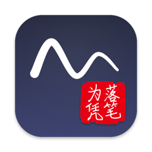
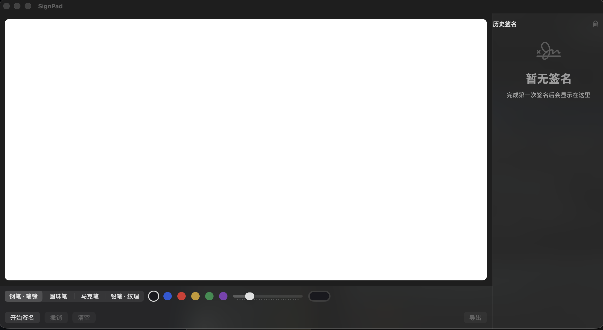
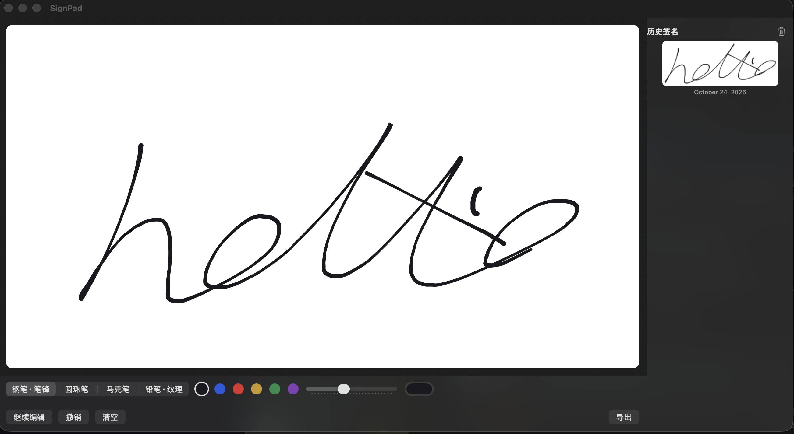

<div align="center">



# ✍️ SignPad

**Turn your MacBook trackpad into a signature pad. Native, private, zero dependencies.**

Sign on the trackpad → tune the ink → export PDF/SVG/PNG → keep a replayable history

[](https://github.com/y2050802852-ux/SignPad/releases/latest)


*Pure native · No API keys · No third-party dependencies · Data stays local*

[English](README.md) | [简体中文](README.zh-CN.md)

</div>

---

## 📸 Screenshots

<div align="center">

<p><sub>Full-window frosted glass, white ink canvas, two-row toolbar, history sidebar with one-click clear. The chrome picks up whatever is behind the window.</sub></p>

<p><sub>A finished signature on the canvas — velocity-synthesized stroke weight, ready for export or re-edit.</sub></p>
</div>

---

## ✨ Features

### 🖌️ Four brushes with velocity-driven stroke weight
- **钢笔·笔锋 (fountain)** / **圆珠笔 (ballpoint)** / **马克笔 (marker)** / **铅笔·纹理 (pencil grain)** — macOS trackpads expose no pressure API, so force is **synthesized from stroke velocity** (gamma-eased), and every stroke records the scale it was drawn with
- **Global width slider 0.5×–3×** — applied at geometry construction, captured per stroke, so replay and export never drift when the slider changes later
- Six-color palette plus a live color well that always mirrors the active color

### 🖐️ Full-window capture mode
- Click **开始签名** and the pointer freezes and disappears — write anywhere over the window (toolbar, sidebar, wherever your finger roams); **Enter / Esc** ends the session. The white canvas is display-only; a full-window transparent overlay receives the raw trackpad touches
- Breathing accent border marks capture state; cmd-tab away and the session is cancelled safely (canvas kept, nothing saved)
- **Esc / Enter / buttons** all funnel through one commit path; empty sessions never create history entries

### 📄 Vector export trio
- One click exports **PDF + SVG + PNG @4×** to `~/Desktop/签名/` — vector PDF/SVG for print, hi-res PNG for chat apps
- Success toast with **Reveal in Finder**; failures surface as an alert; duplicate exports auto-uniquify filenames
- PNG rendering uses a raw CoreGraphics bitmap context (no DPI double-scaling; regression-tested for actual ink pixels)

### 🗂️ Replayable history
- Every committed signature is stored via **SwiftData** (`~/Library/Application Support/SignPad/`) with a thumbnail and the full stroke JSON
- Click a thumbnail to **load it back onto the canvas** (stays idle) → 继续编辑 to re-ink, change pen/color/width, and commit as a new record
- **⌘Z undo** works in both idle and capture; **one-click clear-all** in the sidebar (with confirmation)

### 🧊 Real frosted glass
- The whole window chrome is `NSVisualEffectView` with `.underWindowBackground` — the strongest see-through macOS offers; the desktop glows through
- The app icon is rendered by SignPad's own ink pipeline: a Catmull-Rom + ribbon-outline white swoosh and the user's hand-drawn seal (border flood-fill keyed from a photo), the classic signature-plus-stamp composition

### 🌐 Bilingual UI
- Bilingual UI (Simplified Chinese / English), switch in Settings (⌘,)

---

## 🛠️ How It Works

| Layer | Choice | Notes |
|---|---|---|
| Capture | AppKit `NSTouch` (`.direct` + `.indirect`) on a full-window overlay | writing works regardless of pointer position; the canvas NSView is display-only |
| Force | **Velocity → pressure synthesis** (`PenDynamics`, gamma 0.7) | trackpads expose no pressure; speed is the honest signal |
| Ink | Catmull-Rom smoothing → **normal-offset ribbon outlines** / centered strokes / seeded grain | one geometry pipeline for canvas, thumbnails, and all exporters |
| Export | PDF (CGContext), SVG (hand-written, region-independent formatting), PNG (raw CG bitmap @4×) | no DPI magic, deterministic pixels |
| Storage | SwiftData (`@Model`) with custom Codable for schema evolution | legacy strokes decode with `widthScale = 1` |
| UI | SwiftUI `HStack` deterministic layout + `NSVisualEffectView` | two-row toolbar, sidebar pinned at 240pt |

## 📦 Download

Grab `SignPad-1.0.0.dmg` from [**Releases**](https://github.com/y2050802852-ux/SignPad/releases/latest), open it and drag **SignPad.app** into `Applications`.

> Requires macOS 15 (Sequoia) or later, Apple Silicon. Ad-hoc signed (not notarized): if Gatekeeper complains, right-click the app → **Open**.

### Build from source

```bash
git clone https://github.com/y2050802852-ux/SignPad.git
cd SignPad
open SignPad.xcodeproj    # Xcode 16+, just ⌘R
```

Regenerate the app icon any time with `swift Scripts/make_icon.swift <output-dir>`.

## 📄 License

MIT
